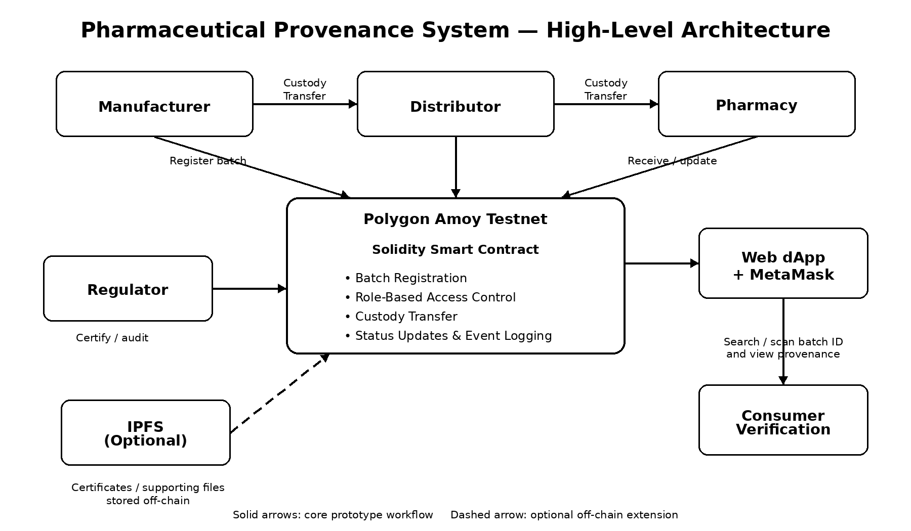

# CSE540-Pharmaceutical-Provenance
# Blockchain-Based Pharmaceutical Drug Provenance and Anti-Counterfeit System

Blockchain-based pharmaceutical drug provenance and anti-counterfeit system using Solidity and Polygon Amoy Testnet.

CSE 540 — Engineering Blockchain Applications  
Fall B 2026 — Project Group 1

## Project Overview

This project develops a blockchain-based prototype for tracking pharmaceutical batches as they move through a supply chain. The system uses a Solidity smart contract to maintain a tamper-evident record of batch registration, custody transfers, status changes, and regulatory verification.

The prototype models interactions among manufacturers, distributors, pharmacies, regulators, and consumers. Authorized stakeholders can perform role-specific blockchain transactions, while consumers can retrieve batch information and verify its recorded provenance.

The smart contract is designed for deployment on the Polygon Amoy Testnet. The current repository represents the Smart Contract Design Draft milestone and establishes the contract structure and interfaces that will support later development.

## System Workflow

The prototype models the following pharmaceutical supply-chain workflow:

Manufacturer → Distributor → Pharmacy → Consumer Verification

A regulator independently approves supply-chain stakeholders,
verifies pharmaceutical batches, and can flag or recall suspicious batches.

A typical batch lifecycle is:

1. The administrator deploys the smart contract.
2. The administrator appoints an authorized regulator.
3. The regulator approves Manufacturer, Distributor, and Pharmacy wallet addresses.
4. A manufacturer registers a pharmaceutical batch.
5. The manufacturer transfers custody to an authorized distributor.
6. The distributor transfers custody to an authorized pharmacy.
7. The pharmacy updates the batch status from `InTransit` to `AtPharmacy`.
8. The pharmacy updates the batch status from `AtPharmacy` to `Dispensed`.
9. A regulator can verify, flag, or recall a registered batch.
10. Consumers retrieve batch information and verify its recorded provenance.

The supported batch lifecycle is:

`Manufactured → InTransit → AtPharmacy → Dispensed`

A regulator may recall a batch from any non-recalled lifecycle state.
Flagging a batch records a warning without changing its lifecycle status.

Major state changes emit blockchain events to provide an auditable
provenance history.
## System Architecture

The high-level architecture shows how pharmaceutical supply-chain stakeholders interact with the Solidity smart contract, web dApp, and optional off-chain storage.

## Stakeholder Roles

### Administrator
- Deploys the smart contract.
- Appoints authorized regulators using `registerRegulator()`.
- Does not directly approve supply-chain stakeholders.

### Manufacturer
- Registers pharmaceutical batches.
- Becomes the initial custodian of registered batches.
- Transfers manufactured batches to authorized distributors.

### Distributor
- Receives pharmaceutical batches from manufacturers.
- Transfers in-transit batches to authorized pharmacies.

### Pharmacy
- Receives pharmaceutical batches from distributors.
- Updates batch status from `InTransit` to `AtPharmacy`.
- Marks batches as `Dispensed`.
- Represents the final supply-chain custodian.

### Regulator
- Approves Manufacturers, Distributors, and Pharmacies.
- Verifies registered pharmaceutical batches.
- Flags suspicious batches with a recorded reason.
- Recalls pharmaceutical batches when necessary.

### Consumer
- Does not require a blockchain role or wallet for read-only queries.
- Retrieves pharmaceutical batch information and verification status.
- Can view recorded flagging and recall information.

## Smart Contract Design

The main smart contract is:

`contracts/PharmaceuticalProvenance.sol`

The contract currently defines:

### Data Structures
- `Role` — identifies authorized stakeholder types.
- `BatchStatus` — represents the pharmaceutical batch lifecycle.
- `DrugBatch` — stores the current on-chain state of a registered batch.

### Access Control
The contract uses modifiers to restrict sensitive operations:

- `onlyAdmin`
- `onlyRole`
- `batchExists`
- `onlyCurrentCustodian`

### Core Functions

`registerRegulator(address account)`  
Allows the contract administrator to appoint an authorized regulator.

`registerStakeholder(address account, Role role)`  
Allows an authorized regulator to approve Manufacturers, Distributors, and Pharmacies.

`registerBatch(string batchId, string drugName, uint256 manufactureDate, uint256 expirationDate, string certificateHash)`  
Allows an authorized manufacturer to register a new pharmaceutical batch.

`transferCustody(string batchId, address newCustodian)`  
Transfers a batch from its current custodian to the next authorized supply-chain participant. Recalled or dispensed batches cannot be transferred.

`updateBatchStatus(string batchId, BatchStatus newStatus)`  
Allows the current Pharmacy custodian to update a batch from `InTransit` to `AtPharmacy`, and then to `Dispensed`.

`verifyBatch(string batchId)`  
Allows an authorized regulator to verify a registered batch that has not been recalled.

`recallBatch(string batchId, string reason)`  
Allows an authorized regulator to recall a batch and record the recall reason.

`flagBatch(string batchId, string reason)`  
Allows an authorized regulator to flag a suspicious batch without changing its lifecycle status.

`getBatch(string batchId)`  
Returns the current batch information, including its status, verification status, flag status, and flag reason.

`isBatchVerified(string batchId)`  
Returns whether a registered batch has been verified by a regulator.

## Blockchain Events

The smart contract emits the following events:

- `StakeholderRegistered` — Records regulator appointments and stakeholder approvals.
- `BatchRegistered` — Records new pharmaceutical batch registrations.
- `CustodyTransferred` — Records changes in batch custody.
- `BatchStatusUpdated` — Records batch lifecycle status changes, including recalls.
- `BatchVerified` — Records regulatory verification of batches.
- `BatchRecalled` — Records batch recalls, regulator addresses, and recall reasons.
- `BatchFlagged` — Records suspicious batch flags, regulator addresses, and flagging reasons.

These events provide an auditable history of important pharmaceutical supply-chain operations without duplicating the entire transaction history in contract storage.

## Repository Structure

    CSE540-Pharmaceutical-Provenance/
    |
    |-- README.md
    |
    |-- contracts/
    |   |-- PharmaceuticalProvenance.sol
    |
    |-- docs/
        |-- architecture.png

The `docs` directory is intended for supporting project documentation and architecture diagrams.

## Dependencies and Tools

The current Smart Contract Design Draft uses:

- Solidity `^0.8.20`
- Remix IDE
- Ethereum Virtual Machine (EVM)
- Polygon Amoy Testnet for planned testnet deployment
- MetaMask for planned wallet interaction
- GitHub for source-code management and team collaboration

Future development may use Ethers.js for web application integration and IPFS for optional off-chain certificate storage.

## Setup

### 1. Clone the Repository

    git clone https://github.com/madhurika6232/CSE540-Pharmaceutical-Provenance.git

    cd CSE540-Pharmaceutical-Provenance

Alternatively, the Solidity contract can be opened directly in Remix IDE.

### 2. Open the Contract in Remix

Open:

https://remix.ethereum.org

Create or import:

    contracts/PharmaceuticalProvenance.sol

### 3. Compile

Use a Solidity compiler compatible with:

    pragma solidity ^0.8.20;

The updated smart contract was successfully compiled using Solidity 0.8.34 in Remix IDE. The contract specifies `pragma solidity ^0.8.20`, which is compatible with this compiler version.

### 4. Local Deployment

For local testing in Remix:

1. Open **Deploy & Run Transactions**.
2. Select **Remix VM** as the environment.
3. Select `PharmaceuticalProvenance`.
4. Deploy the contract.
5. The deploying wallet becomes the contract administrator.

No constructor parameters are required.

## Basic Usage

The following example demonstrates the intended workflow.

### Register Stakeholders

First, the contract administrator appoints an authorized regulator:

`registerRegulator(regulatorAddress)`

The authorized regulator then approves Manufacturer, Distributor, and Pharmacy wallet addresses:

`registerStakeholder(account, role)`

Role values are:

- `0` = None
- `1` = Manufacturer
- `2` = Distributor
- `3` = Pharmacy
- `4` = Regulator

Only the administrator can appoint regulators, while only authorized regulators can approve supply-chain stakeholders.

### Register a Pharmaceutical Batch

Switch to a registered Manufacturer account and call:

    registerBatch(
        "MED-2026-001",
        "Amoxicillin 500mg",
        1767225600,
        1830297600,
        "QmDemoCertificateHash001"
    )

The manufacturer becomes the initial custodian and the batch begins with the `Manufactured` status.

### Transfer Custody

The current custodian can call:

    transferCustody("MED-2026-001", newCustodianAddress)

A successful transfer changes the current custodian and sets the batch status to `InTransit`.

### Update Batch Status

Only the current Pharmacy custodian can manually update a batch's lifecycle status.

Call:

`updateBatchStatus("MED-2026-001", newStatus)`

Batch status values are:

- `0` = Manufactured
- `1` = InTransit
- `2` = AtPharmacy
- `3` = Dispensed
- `4` = Recalled

Valid manual status transitions are:

- `InTransit` → `AtPharmacy`
- `AtPharmacy` → `Dispensed`

Custody transfers automatically set the status to `InTransit`.

The `Recalled` status can only be assigned by an authorized regulator using `recallBatch()`. Recalled or dispensed batches cannot be transferred.

### Verify the Batch

An authorized Regulator can verify a registered pharmaceutical batch that has not been recalled:

`verifyBatch("MED-2026-001")`

A batch can only be verified once.

### Flag a Suspicious Batch

An authorized Regulator can flag a suspicious batch and record the reason:

`flagBatch("MED-2026-001", "Suspected counterfeit packaging")`

Flagging sets the batch's `flagged` field to `true` and stores the `flagReason` without changing its lifecycle status.

A batch cannot be flagged more than once or flagged after recall.

### Recall a Batch

An authorized Regulator can recall a pharmaceutical batch:

`recallBatch("MED-2026-001", "Product safety concern")`

Recalling changes the lifecycle status to `Recalled` and emits `BatchStatusUpdated` and `BatchRecalled` events.

Recalled batches cannot be transferred, dispensed, or newly verified.

### Retrieve Provenance Information

Anyone can use the read-only functions:

    getBatch("MED-2026-001")

and:

    isBatchVerified("MED-2026-001")

to retrieve the current batch information and regulatory verification status.

## Current Development Status

The Smart Contract Design Draft currently includes:

- Smart contract structure and interfaces
- Stakeholder role definitions
- Pharmaceutical batch data model
- Administrator-controlled regulator appointment
- Regulator-controlled stakeholder approval
- Role-based access control
- Pharmaceutical batch registration
- Manufacturer-to-distributor custody transfer
- Distributor-to-pharmacy custody transfer
- Batch lifecycle status updates
- Regulatory batch verification
- Batch flagging with recorded reasons
- Batch recall functionality
- Blockchain events for major operations
- Public read-only provenance functions
- Successful Solidity compilation using version 0.8.34 in Remix IDE

The implemented batch lifecycle is:

`Manufactured → InTransit → AtPharmacy → Dispensed`

Authorized regulators can recall a batch from any non-recalled lifecycle state. They can also flag suspicious batches without changing their lifecycle status.

The updated contract has been successfully compiled in Remix IDE. End-to-end transaction testing and deployment validation remain planned for subsequent development.

## Planned Development

Later project milestones will extend the current foundation with:

- Polygon Amoy Testnet deployment
- MetaMask integration
- Web-based dApp interface
- Consumer provenance visualization
- QR-based batch lookup, if time permits
- Optional IPFS-backed certificate storage
- Additional testing and gas-cost analysis

## Team Members

- Madhurika Kandukoori
- Jahnavi Krishna Kovvuri
- Anvitha Nagireddy
- Charan Kappala
- Guru Charan Alla
